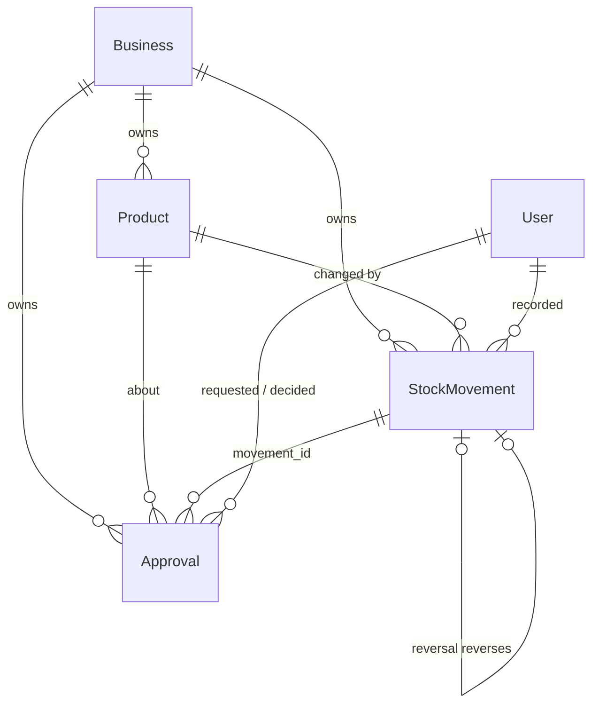

# Entities — backend

Entities of the stock module (`apps/api/src/modules/stock`), as built by migrations `0002_stock.sql` to `0005_approvals.sql`. Business, User and Session come from the identity module (`construction/walking-skeleton/functional-design/entities.md`, migration `0001_identity.sql`). Every entity below carries `businessId`, and every query filters by the caller's business (BR6.1).

Quantities are whole numbers of the product's own unit (pcs, ctn, bag and so on; one unit per product). Money is stored as whole **poisha** (1 taka = 100 poisha) in `integer` columns so sums stay exact; the API sends taka (`fromPoisha`) and receives taka with at most 2 decimals (`toPoisha`).

```yaml
entities:
  - name: Product
    table: products
    description: One stock item of the business, with its current sellable quantity, its Damaged hold and its unit cost
    attributes:
      - { name: id, type: uuid, required: true, unique: true, default: gen_random_uuid() }
      - { name: businessId, column: business_id, type: uuid, required: true, references: Business.id }
      - { name: sku, type: text, required: true, min: 1, max: 40, constraints: [trimmed, unique per business (products_business_sku_key), cannot be changed after creation] }
      - { name: name, type: text, required: true, min: 1, max: 100, constraints: [trimmed] }
      - { name: unit, type: text, required: true, min: 1, max: 20, examples: [pcs, ctn, bag] }
      - { name: minStock, column: min_stock, type: integer, required: true, default: 0, constraints: [">= 0", "<= 1,000,000 (API)"] }
      - { name: onHand, column: on_hand, type: integer, required: true, default: 0, constraints: ["products_on_hand_not_negative: on_hand >= 0", changed only together with a stock movement] }
      - { name: damaged, type: integer, required: true, default: 0, constraints: ["products_damaged_not_negative: damaged >= 0", units flagged as damaged and waiting for a decision; not part of onHand] }
      - { name: unitCost, column: unit_cost, type: integer (poisha), required: true, default: 0, constraints: ["products_unit_cost_not_negative: >= 0", "<= 10,000,000 taka (API)"] }
      - { name: createdAt, column: created_at, type: timestamptz, required: true, default: now() }
    derived:
      - { name: stockValue, rule: "onHand x unitCost (taka)" }
      - { name: status, rule: "out when onHand = 0; low when onHand <= minStock; otherwise ok" }

  - name: StockMovement
    table: stock_movements
    description: One permanent change of a product's stock. Inserted, never updated or deleted (database trigger)
    attributes:
      - { name: id, type: uuid, required: true, unique: true }
      - { name: businessId, column: business_id, type: uuid, required: true, references: Business.id }
      - { name: productId, column: product_id, type: uuid, required: true, references: Product.id }
      - { name: direction, type: enum, required: true, allowed: [in, out] }
      - { name: reason, type: enum, required: true, allowed: [purchase, return, sale, damage, adjustment, count, opening, damage_flagged, damage_rejected, reversal] }
      - { name: quantity, type: integer, required: true, constraints: ["> 0", "<= 1,000,000 (API)"] }
      - { name: balanceAfter, column: balance_after, type: integer, required: true, constraints: [">= 0", the product's onHand right after this movement] }
      - { name: unitCost, column: unit_cost, type: integer (poisha), required: true, default: 0, constraints: [">= 0", the product's unit cost at the moment of the movement] }
      - { name: note, type: text, required: false, max: 200 }
      - { name: userId, column: user_id, type: uuid, required: true, references: User.id, description: the person who recorded or decided it }
      - { name: reversesMovementId, column: reverses_movement_id, type: uuid, required: false, references: StockMovement.id, description: set only on a reversal }
      - { name: createdAt, column: created_at, type: timestamptz, required: true, default: now() }
    constraints:
      - "stock_movements_no_update_or_delete: a BEFORE UPDATE OR DELETE trigger raises 'stock movements cannot be changed or deleted' (restrict_violation)"
    indexes:
      - stock_movements_business_created_idx (business_id, created_at DESC)
      - stock_movements_product_created_idx (product_id, created_at DESC)

  - name: Approval
    table: approvals
    description: A damage flag or a reversal request that waits for a second person's decision
    attributes:
      - { name: id, type: uuid, required: true, unique: true }
      - { name: businessId, column: business_id, type: uuid, required: true, references: Business.id }
      - { name: kind, type: enum, required: true, allowed: [damage, reversal] }
      - { name: productId, column: product_id, type: uuid, required: true, references: Product.id }
      - { name: quantity, type: integer, required: true, constraints: ["> 0"] }
      - { name: unitCost, column: unit_cost, type: integer (poisha), required: true, constraints: [">= 0", the product's unit cost when the request was made] }
      - { name: note, type: text, required: false, max: 200, description: "damage: optional note; reversal: the required reason" }
      - { name: movementId, column: movement_id, type: uuid, required: true, references: StockMovement.id, description: "damage: the damage_flagged movement; reversal: the movement to undo" }
      - { name: status, type: enum, required: true, default: pending, allowed: [pending, approved, rejected] }
      - { name: requestedBy, column: requested_by, type: uuid, required: true, references: User.id }
      - { name: requestedAt, column: requested_at, type: timestamptz, required: true, default: now() }
      - { name: decidedBy, column: decided_by, type: uuid, required: false, references: User.id }
      - { name: decidedAt, column: decided_at, type: timestamptz, required: false }
      - { name: resultMovementId, column: result_movement_id, type: uuid, required: false, references: StockMovement.id, description: "the damage_rejected or reversal movement the decision wrote" }
    constraints:
      - "approvals_decided_by_someone_else: decided_by IS NULL OR decided_by <> requested_by"
      - "approvals_decision_complete: pending has no decider and no decision time; approved or rejected has both"
      - "approvals_one_reversal_per_movement: unique (movement_id) WHERE kind = 'reversal' AND status IN ('pending', 'approved')"
    indexes:
      - approvals_business_status_idx (business_id, status, requested_at DESC)
```

## Movement Reasons

| Reason | Direction | Written by | Chosen by hand? |
|---|---|---|---|
| purchase | in | Stock in / out | yes |
| return | in | Stock in / out (customer return) | yes |
| sale | out | Stock in / out | yes |
| damage | out | Stock in / out, Owner or Manager only (direct write-off) | yes |
| adjustment | in or out | Stock in / out | yes |
| count | in (extra) or out (missing) | Stock count | no |
| opening | in | Product import (opening stock) | no |
| damage_flagged | out | Flag damage (units move into the Damaged hold) | no |
| damage_rejected | in | Rejecting a damage flag (units return from the hold) | no |
| reversal | opposite of the original | Approving a reversal | no |

## Relationships



<!-- Text fallback: A Business owns Products, StockMovements and Approvals. A Product has many StockMovements; each movement is recorded by one User. A reversal movement points at the movement it reverses. An Approval is about one Product and points at one StockMovement (the flagged movement or the movement to undo); it is requested by one User and decided by another. -->

## Invariants

| Invariant | How it holds |
|---|---|
| `onHand >= 0` | Database check, plus the conditional update `on_hand + delta >= 0` (BR8.3) |
| `damaged >= 0` | Database check; only flag (+q) and decision (−q) change it, inside the same transactions |
| `onHand` = sum of the product's movements (in minus out) | Every change of `on_hand` is written in the same transaction as its movement (BR8.4); import writes the opening movement with the product |
| Movements are permanent | Database trigger (BR8.5) |
| An approval is never decided by its requester | Service check and database check (BR12.2) |
| At most one open or approved reversal per movement | Partial unique index (BR13.5) |

## Summary

| Entity | Purpose | Key rules |
|---|---|---|
| Product | Stock item with quantity, Damaged hold and unit cost | SKU unique per business; quantity never below zero; money in poisha |
| StockMovement | Append-only stock ledger | Balance after and unit cost kept per movement; no update or delete |
| Approval | Damage flags and reversal requests | Decided once, by someone other than the requester |

## Assumptions & Open Questions

None.
