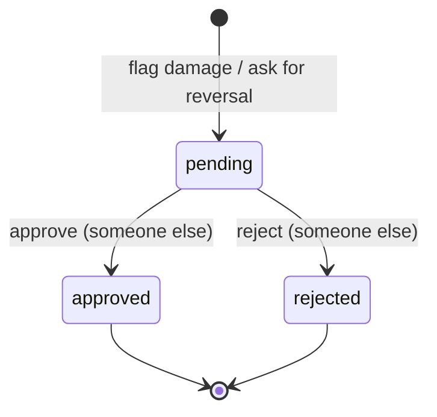

# Functional Specification — backend

Behaviour of the stock module (`apps/api/src/modules/stock`) as built: products, the append-only stock ledger, stock counts, product import with opening stock, damage flags, approvals and reversals, the dashboard, history, the stock report, CSV downloads and My record. Data shapes are in `entities.md`; decision logic in `rules.md`. Sign-up, sign-in, sessions, staff and passwords belong to the identity module and are specified in `construction/walking-skeleton/functional-design/`.

Stories delivered: US-05 to US-16 (US-03 and US-04 for the server-side role checks they rely on).

## Permissions

The identity module's `authorize(caller, action)` refuses a missing or inactive caller. Role limits are checked inside each stock service function (BR6.3, BR8.2, BR12.1, BR13.1, BR19.1).

| Action | Owner | Manager | Supervisor | Worker / Sales rep / Accountant |
|---|---|---|---|---|
| Read products, dashboard, history, report, approvals, CSV downloads | yes | yes | yes | yes |
| Create, edit, import products | yes | yes | no | no |
| Stock in / out (purchase, return, sale, adjustment) | yes | yes | yes | yes |
| Stock out as damaged (direct write-off) | yes | yes | no | no |
| Stock count, Flag damage | yes | yes | yes | yes |
| Decide a damage flag (never own) | yes | yes | yes | no |
| Ask for / decide a reversal (never own) | yes | yes | no | no |
| Own record / anyone's record | yes / yes | yes / yes | yes / no | yes / no |

## Workflows

### WF6 Manage and find products (US-05; FR-6, FR-7, FR-17)

1. `GET /api/v1/products?q=` lists the business's products ordered by name then SKU, each with in stock, damaged, minimum stock, unit cost, stock value and status (BR7.4, BR7.5, BR14.1).
2. `POST /api/v1/products` (Owner/Manager) validates the body (BR7.2), inserts the product with quantity 0 and returns **201**; a SKU clash returns 409 DUPLICATE (BR7.1).
3. `PATCH /api/v1/products/:id` (Owner/Manager) changes name, unit, minimum stock or unit cost (BR7.3) and returns the product.

### WF7 Import products from Excel (US-06; FR-8)

1. The web app reads the CSV in the browser, checks every row with the shared row schema and lists problems by spreadsheet row; only a clean file is sent.
2. `POST /api/v1/products/import` (Owner/Manager) checks the rows again (BR10.1), refuses duplicate SKUs in the file or in the business (BR10.2), then creates every product and its opening movement in one transaction (BR10.3). Returns **201** with `created` and `openingUnits`.

### WF8 Record stock in / out (US-07; FR-9, FR-10, FR-11, FR-23)

1. `POST /api/v1/stock/movements` with product, direction, reason, quantity and optional note.
2. The service validates (BR8.1) and refuses a direct damage write-off from anyone but an Owner or Manager (BR8.2).
3. In one transaction `applyMovement` runs the conditional quantity update (BR8.3) and inserts the movement with balance after and the unit cost of the moment (BR8.4).
4. Returns **201** with the movement (including `balanceAfter`), which the page shows as the new balance. A shortfall returns 409 INSUFFICIENT_STOCK "Only N unit in stock."

### WF9 Count stock (US-08; FR-12)

1. `POST /api/v1/stock/counts` with product, counted quantity and optional note.
2. In one transaction the product row is locked, the difference worked out, and a count movement written through `applyMovement` unless the count matches (BR9.1).
3. Returns **201** with previous, counted, difference and the movement (or null). The page shows missing or extra in units and taka.

### WF10 Flag damage (US-09; FR-13)

1. `POST /api/v1/stock/damage-flags` with product, quantity and optional note.
2. In one transaction: `damage_flagged` out movement, `products.damaged` increased, pending damage approval inserted (BR11.1).
3. Returns **201** with the approval card.

### WF11 Decide an approval (US-10, US-11; FR-14, FR-15, FR-16, FR-23)

1. `GET /api/v1/approvals?status=pending|decided` lists cards with `canDecide` per caller (BR12.7), newest first. Optional `limit` 1–200 (default 200) and `offset` 0–1,000,000 page the list; the web app asks for 50 per page and "Load more" sends the next offset. The Products and Report pages load their full list once and show 50 rows at a time with "Load more".
2. `POST /api/v1/approvals/:id/approve` or `/reject`. In one transaction the approval row is locked (BR12.3), the decider is checked against the kind and the requester (BR12.1, BR12.2), the effect is applied (BR12.4 for damage, BR12.5 for reversal) and the decision recorded (BR12.6).
3. Returns **200** with the updated card. A second decision returns 409 "This was already decided."

### WF12 Ask for a reversal (US-11; FR-15)

1. From the history, an Owner or Manager chooses Reverse… on a row and gives a reason.
2. `POST /api/v1/approvals/reversals` checks the role (BR13.1), the movement and the reason (BR13.2), whether the reason can be reversed (BR13.3), and inserts a pending reversal approval; a second open or approved reversal of the same movement returns 409 (BR13.4).
3. A different Owner or Manager approves it in Approvals (WF11).

### WF13 Dashboard (US-12; FR-18, FR-17)

`GET /api/v1/dashboard` returns the figures in BR15.1. The web app shows the approvals banner, the value and loss tiles (each loss tile links to the history filtered by its reason), the low-stock list and recent movements.

### WF14 History (US-13; FR-19)

`GET /api/v1/stock/movements` with the filters in BR16.1. The web app keeps the filters in the address and asks for 50 rows per page ("Load more" sends the next offset).

### WF15 Stock report (US-14; FR-20)

`GET /api/v1/reports/stock?from=&to=` returns lines and totals per BR17.1. The web app defaults to this month.

### WF16 CSV downloads (US-15; FR-21)

`GET /api/v1/products/export.csv`, `GET /api/v1/stock/movements/export.csv` (history filters) and `GET /api/v1/reports/stock.csv?from=&to=` return files per BR18.1 and BR18.2.

### WF17 My record (US-16; FR-22)

`GET /api/v1/me/record?userId=` returns today, week and month figures per BR19.1 and BR19.2. Owners and Managers choose the person from `GET /api/v1/users/names`.

## State Machines

### Approval

| Current state | Event | Guard | Next state | Actions |
|---|---|---|---|---|
| (none) | Flag damage | stock ≥ quantity | pending (damage) | `damage_flagged` movement; damaged += q |
| (none) | Ask for reversal | Owner/Manager; reversible reason; no open or approved reversal | pending (reversal) | none |
| pending (damage) | Approve | Supervisor/Manager/Owner, not the requester | approved | damaged −= q |
| pending (damage) | Reject | same | rejected | damaged −= q; `damage_rejected` in movement |
| pending (reversal) | Approve | Owner/Manager, not the requester; stock stays ≥ 0 | approved | `reversal` movement linked to the original |
| pending (reversal) | Approve | would take stock below zero | pending | refused with INSUFFICIENT_STOCK; nothing saved |
| pending (reversal) | Reject | Owner/Manager, not the requester | rejected | none; a new reversal may be asked |

approved and rejected are final; any later decision returns 409 DUPLICATE.

<!-- Text fallback: An approval starts pending when damage is flagged or a reversal is asked for. Someone other than the requester approves or rejects it once; approved and rejected are final. -->

## Worked Examples

- **Last unit race (FR-10):** a product has 1 unit; two sales of 1 arrive together. The first conditional update sets on_hand to 0; the second updates no row and gets "Only 0 pcs in stock."
- **Count (FR-12):** system has 50 bags, Rafiq counts 47. A count out movement of 3 is written with note "Counted 47, system had 50."; at ৳1,200 a bag the page shows ৳3,600 missing.
- **Damage flag rejected (FR-14):** Karim flags 2 bags (on_hand 47 → 45, damaged 2). Nasima rejects: damaged 0, `damage_rejected` in 2, on_hand 47. The dashboard's damage-flag loss nets to 0.
- **Reversal (FR-15):** Haque asks to reverse a purchase of 10 recorded by mistake. Rafiq approves: a reversal out of 10 is written, linked to the purchase. A second request for the same purchase returns 409.

## API (all under `/api/v1`, behind authentication and the CSRF check)

| Method and path | Purpose | Success |
|---|---|---|
| GET `/products?q=` | List and search products | 200 |
| POST `/products` | Create a product | 201 |
| PATCH `/products/:id` | Edit a product | 200 |
| POST `/products/import` | Import products with opening stock | 201 |
| GET `/products/export.csv` | Products CSV | 200 |
| POST `/stock/movements` | Stock in / out | 201 |
| GET `/stock/movements` | History | 200 |
| GET `/stock/movements/export.csv` | History CSV | 200 |
| POST `/stock/counts` | Stock count | 201 |
| POST `/stock/damage-flags` | Flag damage | 201 |
| GET `/approvals?status=` | Approvals inbox | 200 |
| POST `/approvals/reversals` | Ask for a reversal | 201 |
| POST `/approvals/:id/approve`, `/approvals/:id/reject` | Decide | 200 |
| GET `/dashboard` | Dashboard | 200 |
| GET `/reports/stock?from=&to=` | Stock report | 200 |
| GET `/reports/stock.csv?from=&to=` | Report CSV | 200 |
| GET `/me/record?userId=` | My record | 200 |

Each change logs one structured event (`stock.product_created`, `stock.product_updated`, `stock.products_imported`, `stock.movement_recorded`, `stock.count_recorded`, `stock.damage_flagged`, `stock.reversal_requested`, `stock.approval_decided`).

## Error Catalogue (additions to the identity module's)

| Code | Status | When |
|---|---|---|
| VALIDATION_FAILED | 400 | Field rules (BR7.2, BR8.1, BR9.1, BR10.1, BR10.2, BR13.2, BR13.3, BR16.1, BR17.1); direct damage by other roles (BR8.2) |
| DUPLICATE | 409 | SKU exists (BR7.1); already decided (BR12.3); reversal already asked or approved (BR13.4) |
| INSUFFICIENT_STOCK | 409 | Stock would go below zero (BR8.3, BR11.1, BR12.5) |
| FORBIDDEN | 403 | Role limits (BR6.3, BR12.1, BR13.1, BR19.1); deciding own request (BR12.2) |
| NOT_FOUND | 404 | Unknown or other business's product, approval or person (BR6.1) |

## Assumptions & Open Questions

None.
