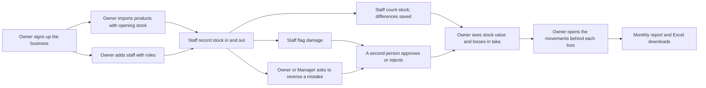

# Scope Document — Mojud core slice

Updated 2026-11-16 to match the built app.

Inputs: the intent statement (`ideation/intent-capture/intent-statement.md`, "intent-statement"), the feasibility assessment (`ideation/feasibility/feasibility-assessment.md`, "feasibility-assessment"), the constraint register (`ideation/feasibility/constraint-register.md`, "constraint-register"), and the answers in `scope-definition-questions.md`.

## Minimum Viable Scope

The work is done when an Owner can sign up a business, add staff and products (by hand or from Excel), and every staff member can record stock in and out and count stock; damage flags and corrections are decided by a second person; and the owner can see stock value and losses in taka, trace each loss to its movements, run a monthly report and download Excel files. Stock never goes negative, and every change is kept permanently. It all runs on the builder's own machine. (Intent statement S1–S6.)

## In Scope

| # | Capability | Who uses it | Source |
|---|---|---|---|
| 1 | Business sign-up that creates the business and the Owner's account | Owner | Intent statement S1; UX scenario S01 |
| 2 | Sign in and sign out with a phone number and password | All users | Q1 |
| 3 | Six roles (Owner, Manager, Supervisor, Warehouse worker, Sales rep, Accountant), each with fixed permissions | All users | Q5 |
| 4 | Staff: the Owner adds, deactivates and reactivates people and sets a new password for them | Owner | Intent statement S1; UX scenario S01, S08 |
| 5 | Passwords: everyone changes their own password | All users | Q1; UX scenario S08 |
| 6 | Products: SKU, name, unit, minimum stock and unit cost in taka; search; OK / Low / Out status | Owner, Manager (edit); everyone (view) | Intent statement S1 |
| 7 | Import products from Excel with opening stock, all rows or none | Owner, Manager | UX scenario S01 |
| 8 | Stock in and out with a reason and an optional note | All users | Intent statement S2; UX scenario S02 |
| 9 | Stock never goes negative, and every change is a permanent stock movement | (system) | Intent statement S4 |
| 10 | Stock count: enter what is on the shelf; the difference is saved and shown in units and taka | All users | UX scenario S04 |
| 11 | Damage flag: units leave sellable stock and wait for a decision | All users | Intent statement S3; UX scenario S03 |
| 12 | Approvals: a second person approves or rejects damage flags and reversals; nobody decides their own | Supervisor (damage), Manager, Owner | Intent statement S3; UX scenario S03, S05 |
| 13 | Reversal: correct a mistaken movement with an opposite one, linked to the original | Owner, Manager | UX scenario S05 |
| 14 | Dashboard: stock value, losses in the last 30 days split three ways with drill-down, low stock, recent movements | All users | Intent statement S5; UX scenario S05 |
| 15 | Movement history with filters | All users | UX scenario S05 |
| 16 | Monthly stock report and Excel (CSV) downloads | All users | UX scenario S07 |
| 17 | My record: each person's own work for today, the last 7 days and the last 30 days | All users | UX scenario S06 |
| 18 | Desktop and phone screens, light and dark themes, English | All users | Q2 |
| 19 | Runs locally on the builder's machine | Builder | Intent statement S6; constraint register C-T2 |

## Value Stream

How value flows through the app, from setup to a traced loss:

<!-- Text fallback: The Owner signs up the business, imports products with opening stock and adds staff with roles. Staff record stock in and out, count stock (differences are saved) and flag damage. A second person approves or rejects each damage flag, and each reversal that an Owner or Manager asks for. The Owner sees stock value and losses in taka on the dashboard, opens the movements behind each loss, and closes the month with the report and Excel downloads. -->

## Glossary

| Term | Meaning |
|---|---|
| Khata | A paper ledger book that many small Bangladeshi businesses use to keep records |
| SKU | The business's own short code for a product |
| Stock movement | One permanent record of a stock change: product, in or out, reason, quantity, balance after, unit cost at that moment, note, who and when. It is never edited or deleted |
| Stock count | Entering what is actually on the shelf; any difference from the record is saved as a movement |
| Damage flag | A report that some units are damaged; they leave sellable stock and wait for a second person's decision |
| Damaged hold | Units that have been flagged as damaged and are waiting for a decision |
| Write-off | Removing stock as a loss, after a damage flag is approved or by an Owner or Manager directly |
| Reversal | A new movement that cancels a mistaken one by recording the opposite change, approved by a second person |
| Approval | A damage flag or reversal waiting for, or given, a second person's decision |
| Stock value | Quantity in stock times unit cost, in taka |
| My record | A person's own summary of the work they recorded, which is their proof of work |
| Scenario S01–S08 | Numbered user journeys in the UX design, for example S02 Karim records the morning delivery |

## Assumptions & Open Questions

None.
