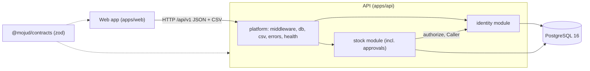

# Components — Mojud core slice

Updated 2026-11-16 to describe the components as built. Sources: the code under `apps/api/src`, `apps/web/src` and `packages/contracts/src`; the migrations `apps/api/migrations/0001`–`0005`; `inception/requirements-analysis/requirements.md` (FR-1 to FR-23, NFR-1 to NFR-9); `inception/user-stories/stories.md` (US-01 to US-16); `inception/delivery-planning/simplified-plan.md`. Decisions are in `decisions.md`.

## Overview

Mojud is one repository with three workspaces:

| Workspace | What it is |
|---|---|
| `apps/api` | One Node service (Express 5, Kysely, PostgreSQL 16): a modular monolith with two business modules, `identity` and `stock`, on a shared `platform` layer |
| `apps/web` | One React 18 single-page app (Vite, React Router, TanStack Query, i18next) |
| `packages/contracts` | `@mojud/contracts`: zod request schemas, response types, limits and field messages used by both the API and the web app |

Text fallback: the web app calls the API over HTTP. Every request passes the platform middleware, then reaches the identity or stock module. The stock module asks identity to authorize the caller. Both modules read and write PostgreSQL. Both the web app and the API import the shared contracts package.

## Component Catalogue

### identity (`apps/api/src/modules/identity`)

**Purpose.** Businesses, people, sessions and passwords (FR-1 to FR-5).

**Public surface** (`index.ts` only): `createIdentityRouters`, `resolveCaller`, `authorize`, `Caller`, `startSessionCleanup`, `equalizeSignInFailure`, `BusinessId`, `UserId`.

**Responsibilities.**
- Sign up: creates the business and its Owner in one transaction and starts a session (FR-1).
- Sign in and out with Argon2id password checks; every sign-in failure gives the same answer and takes about the same time (a dummy hash check runs for an unknown phone or malformed body) (FR-2).
- Sessions: a random cookie value; only its SHA-256 hash is stored; a CSRF token per session; expiry 12 hours after last use; a deactivated user's session is deleted on their next request; expired sessions are cleaned up daily (FR-2).
- Staff: Owner-only list, add, deactivate and reactivate, and password reset; a names list for everyone (FR-3, FR-5).
- Change own password with the current one; other sessions end (FR-5).
- `authorize`: refuses a missing or inactive caller; each operation then checks the role it needs.

**Owns tables.** `businesses`, `users`, `sessions`.

**Internal files.** `routes.ts`, `service.ts` (sign-up, sign-in, sessions, `authorize`), `staff.ts`, `repository.ts`, `password.ts` (Argon2id), `tokens.ts` (session IDs, CSRF tokens, hashing), `cleanup.ts`, `ids.ts`, `types.ts`.

### stock (`apps/api/src/modules/stock`)

**Purpose.** Products, the stock ledger, counts, approvals and everything shown from them (FR-6 to FR-23).

**Public surface** (`index.ts` only): `createStockRouter`, `StockDeps`.

**Responsibilities.**
- Products: create, edit, list and search, import, CSV export; Owner and Manager only for changes (FR-6, FR-7, FR-8).
- Ledger: `applyMovement` is the only code that changes a product's quantity. In the caller's transaction it runs a conditional update (`on_hand + delta >= 0`) and appends one movement holding the balance after and the unit cost at that moment (FR-9, FR-10, FR-11, FR-17).
- Stock in and out by hand, limited to the reasons that fit the direction; `damage` only for Owner and Manager (FR-9, FR-23).
- Stock count: locks the product row, compares, and writes a `count` movement for the difference (FR-12).
- Approvals (`approvals.ts`): damage flags move units into the `damaged` hold and open a `damage` approval; reversals open a `reversal` approval; decisions lock the approval row, refuse the requester, and write `damage_rejected` or `reversal` movements as needed (FR-13 to FR-16, FR-23).
- Insight: dashboard figures and 30-day loss split, movement history with filters and paging, stock report worked back from the ledger, CSV exports, and each person's work record (FR-18 to FR-22).

**Owns tables.** `products`, `stock_movements`, `approvals`.

**Internal files.** `routes.ts`, `service.ts` (products, ledger, counts, history, dashboard, import, export, report), `approvals.ts` (flags, reversals, decisions, work record).

### platform (`apps/api/src/platform`)

**Purpose.** Shared technical pieces with no business rules.

| Piece | What it does |
|---|---|
| `config.ts` | Reads and checks the environment (database URL, allowed origins, cookie `Secure`, Argon2 settings, clock); session lifetime 12 hours; clean-up every 24 hours |
| `db/db.ts`, `db/migrations.ts`, `db/sqlFileMigrationProvider.ts` | Kysely over `pg`; runs the forward-only SQL files in `apps/api/migrations` |
| `middleware/requestId.ts`, `responseTime.ts`, `httpLogger.ts` | `X-Request-Id`, `X-Response-Time`, one pino log line per request with secrets redacted |
| `middleware/originCheck.ts` | Non-GET requests must come from an allowed Origin or Referer |
| `middleware/authenticate.ts`, `csrfCheck.ts`, `extendSession.ts` | Resolve the caller through identity, check the CSRF header on non-GET requests, then move the session expiry |
| `middleware/errorHandler.ts`, `errors.ts`, `validation.ts` | The one error shape, `AppError` codes and statuses, zod validation with field messages |
| `csv.ts` | CSV text with BOM, quoting and formula-injection guard; file download headers; Dhaka time formatting |
| `health.ts`, `openapi.ts`, `log.ts`, `shutdown.ts` | `/health` with a database ping, `/openapi.json`, logger, graceful shutdown |

`app.ts` mounts everything in a fixed order (request ID, logging, helmet, Origin check, 100 KB JSON parser, public routes, authenticate, CSRF, session extension, module routes, not found, error handler) and keeps a route inventory so a test proves no protected route skips authentication.

### contracts (`packages/contracts`)

**Purpose.** One definition of every request and response, used on both sides (NFR-1).

Files: `schemas.ts` (sign-up, sign-in, session, health), `phone.ts` (normalize 6–15 digits), `roles.ts` (six roles), `staff.ts`, `stock.ts` (products, movements, reasons, counts, dashboard, poisha helpers, `stockStatus`), `importReport.ts` (import rows and report), `approvals.ts` (flags, reversals, approvals, work record, decider roles), `errors.ts` (codes and statuses).

### web app (`apps/web/src`)

**Purpose.** The screens (NFR-4, NFR-5).

| Part | Contents |
|---|---|
| `App.tsx`, `layouts/Layouts.tsx` | Routes, lazy-loaded pages, public and signed-in layouts, role-guarded routes, return to the page first asked for |
| `session/SessionProvider.tsx`, `session/roles.ts` | Session state from `/auth/me`, sign out, CSRF token; navigation and route access per role; `canManageProducts` |
| `api/client.ts`, `api/stock.ts` | Fetch wrapper with the CSRF header and the error shape; TanStack Query hooks per endpoint |
| `pages/SignUpPage.tsx`, `pages/SignInPage.tsx` | Public forms |
| `pages/stock/*` | Dashboard, Products, Import, Stock in / out, Stock count, Flag damage, History (with `MovementTable` and Reverse…), Approvals, Report, My record, Staff, My password; `StockBadge` |
| `components/*` | `AppBar`, `SideNav` (bottom tab bar on phones), `SkipLink`, `ThemeSwitch`, `ButtonPrimary`, `ButtonSecondary`, `InputField`, `PasswordField`, `SelectField`, `FormErrorSummary`, `RefusalMessage`, `DownloadLink`, `Icon` |
| `i18n/en.json` | Every piece of screen text, in English |
| `styles/tokens.css`, `styles/base.css`, `theme/theme.ts` | Design tokens as CSS variables for light and dark, layout and breakpoints, theme choice (Light, Dark, Device) applied before first paint |
| `format.ts`, `csvImport.ts`, `useCountUp.ts` | Taka with lakh grouping and dates; CSV parsing and row checks for import; count-up figures on the dashboard |

## Domain Model

| Entity | Table | Key rules |
|---|---|---|
| Business | `businesses` | Every other record belongs to exactly one business |
| User | `users` | One of six roles; phone unique across all businesses; may be inactive; the Owner cannot be deactivated |
| Session | `sessions` | Stored by hash; ends 12 hours after last use, at sign-out, on password change (other sessions) or reset (all), and when the user is deactivated |
| Product | `products` | SKU unique per business and fixed after creation; `on_hand` ≥ 0; `damaged` hold ≥ 0; `unit_cost` in poisha |
| Stock movement | `stock_movements` | Append-only; direction, reason, quantity > 0, balance after, unit cost of its moment, person, time; a reversal links to the movement it undoes |
| Approval | `approvals` | Kind damage or reversal; pending, approved or rejected; decided once, never by the requester; at most one open or approved reversal per movement |

Value types: `Role` (owner, manager, supervisor, warehouse_worker, sales_rep, accountant), `Direction` (in, out), `Reason` (purchase, return, sale, damage, adjustment, count, opening, damage_flagged, damage_rejected, reversal), money in poisha, phone digits.

### Movement reasons

| Reason | Direction | Written by | Reversible |
|---|---|---|---|
| `purchase`, `return` | in | Stock in / out | Yes |
| `sale` | out | Stock in / out | Yes |
| `damage` | out | Stock in / out (Owner, Manager) | Yes |
| `adjustment` | in or out | Stock in / out | Yes |
| `opening` | in | Import | Yes |
| `count` | in or out | Stock count | No |
| `damage_flagged` | out (into the hold) | Flag damage | No |
| `damage_rejected` | in (from the hold) | Rejecting a flag | No |
| `reversal` | opposite of the original | Approving a reversal | No |

## Interactions

- Every stock-changing request runs in one database transaction: product quantity update and movement insert together, plus the approval row or hold change when there is one.
- Import creates every product and its `opening` movements in one transaction, or nothing.
- Deciding an approval selects the row `FOR UPDATE`, checks it is still pending, checks the caller is not the requester and has the right role, writes any movement, then stores the decision.
- The stock module never reads the `sessions` table; it receives the `Caller` from the platform middleware and calls `authorize`.

## Code differences found

- `Caller` still has `warehouseIds`, always empty; nothing reads it.
- The comments in `modules/stock/index.ts` and `identity/internal/types.ts` still describe the early build ("products, stock movements and the dashboard"; "U2 fills it") and do not mention counts, approvals or the work record.
- `authorize` holds no permission table: it only checks that the caller is signed in and active. Role rules sit in each operation (`requireOwner` in `staff.ts`; `requireManager`, `DAMAGE_DECIDER_ROLES` and `REVERSAL_ROLES` in the stock module).

## Assumptions & Open Questions

None.
