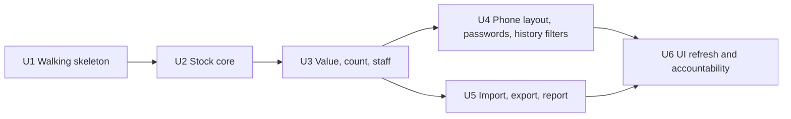

# Unit of Work Dependencies — Mojud core slice

Updated 2026-11-16 to match the units built (`unit-of-work.md`, `simplified-plan.md`).

## Dependency Graph

Text fallback: U1 → U2 → U3; U3 → U4 and U3 → U5; U4 and U5 → U6. They were built in the order U1, U2, U3, U4, U5, U6.

## Dependency Matrix

| Unit | Depends on | Why |
|---|---|---|
| U1 | — | First unit: repository, Compose stack, platform pipeline, identity tables |
| U2 | U1 | Needs businesses, users, sessions, `authorize` and the app shell |
| U3 | U2 | Unit cost and counts extend `products` and `stock_movements`; staff extends identity and needs roles enforced by U2's products rules |
| U4 | U3 | Password reset sits on the Staff page; history filters extend U2's history; the phone layout reworks the shell from U1 |
| U5 | U3 | Import and the report use unit cost and value (U3); history export reuses the filters' query shape |
| U6 | U4, U5 | Reversals start from the filtered History (U4); the loss split and report damage figures extend U3 and U5; the refresh restyles every page built so far |

## Shared Contracts

- `@mojud/contracts` grows with each unit: identity schemas (U1), stock schemas (U2), staff and count schemas (U3), password schemas and movement query (U4), import and report (U5), approvals and work record (U6).
- The `stock_movements` reason check is replaced in migrations 0003, 0004 and 0005; each adds reasons and keeps the old ones.

## Assumptions & Open Questions

None.
