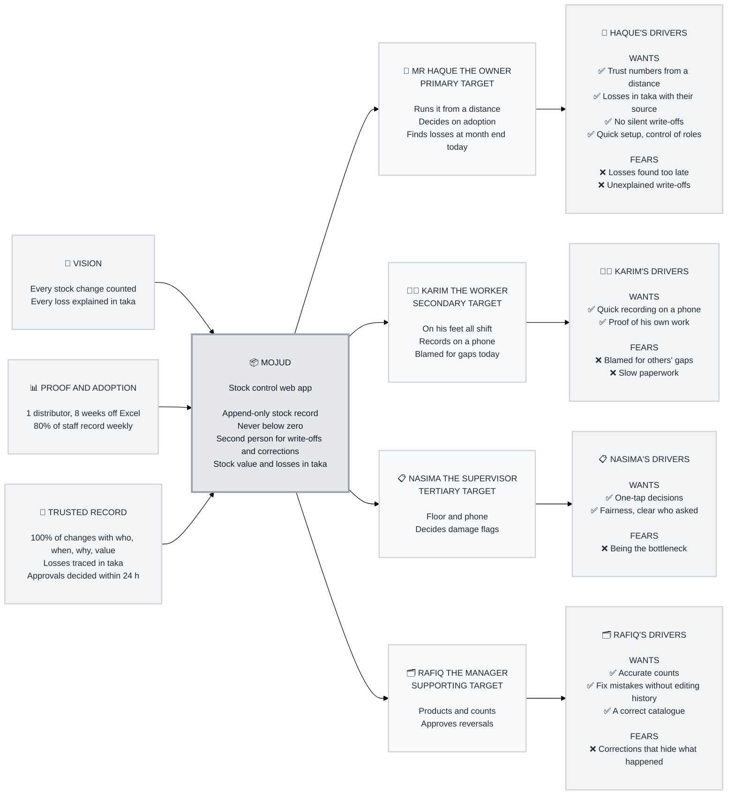
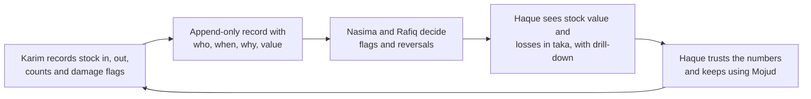

# Trigger Map Poster: Mojud (E2E_IAM)

> Visual overview connecting business goals to user psychology

Updated 2026-11-16 to match the built app.

**Created:** 2026-10-23
**Author:** eshtiakhasan
**Methodology:** Based on Effect Mapping (Balic & Domingues), adapted for the WDS framework
**Path:** Rewritten from the as-built app (`apps/web`, `apps/api`): its screens, roles, stock rules and requirement IDs FR-1 … FR-23

---

## Strategic Documents

- [../A-Product-Brief/project-brief.md](../A-Product-Brief/project-brief.md): strategic foundation
- [personas/03-Haque-the-Owner.md](personas/03-Haque-the-Owner.md): primary persona
- [personas/02-Karim-the-Warehouse-Worker.md](personas/02-Karim-the-Warehouse-Worker.md): secondary persona
- [personas/04-Nasima-the-Supervisor.md](personas/04-Nasima-the-Supervisor.md): tertiary persona
- [personas/05-Rafiq-the-Manager.md](personas/05-Rafiq-the-Manager.md): supporting persona
- [feature-impact-analysis.md](feature-impact-analysis.md): built features scored against the personas

---

## Vision

**"Every stock change counted. Every loss explained in taka."**

Mojud is the stock-control web app a small Bangladeshi FMCG distributor (one
stock location, a handful of staff) runs on instead of Excel or a khata. It
keeps a permanent record of every stock change with who, when, why and the
value in taka, never lets stock go below zero, needs a second person for every
damage write-off and every correction, and shows the owner what his stock is
worth and where it was lost.

---

## Business Objectives

Targets are assumptions until checked with a real distributor. Each one can be
measured with screens the app already has.

### Objective 1: Product proof
- **Metric:** consecutive weeks a real distributor records its stock in Mojud instead of Excel or a khata
- **Target:** 8 consecutive weeks
- **Measured with:** History filtered by from and to date (FR-19); the Report run for each week (FR-20)

### Objective 2: A complete record
- **Metric:** share of stock changes that carry who, when, why and value
- **Target:** 100% (enforced: every change is an append-only movement, FR-11, and stock never goes below zero, FR-10)
- **Measured with:** History and its CSV download (FR-19, FR-21); product quantity always equals the sum of its movements

### Objective 3: Staff record their own work
- **Metric:** share of active staff with at least one movement, count or damage flag in a working week
- **Target:** ≥ 80%
- **Measured with:** My record for any person, last 7 days (FR-22); History filtered by person (FR-19)

### Objective 4: Losses traced in taka
- **Metric:** loss value in the last 30 days split into Written off, Damage flags and Missing in counts; "Missing in counts" value month on month
- **Target:** 100% of loss value traceable to a reason, a person and a time; "Missing in counts" falls month on month
- **Measured with:** Dashboard loss tiles with drill-down to History (FR-18), monthly Report and its CSV (FR-20, FR-21)

### Objective 5: Second-person decisions stay quick
- **Metric:** time from a damage flag or reversal request to its decision; requests waiting
- **Target:** decided within 24 hours; dashboard banner at 0 waiting by end of day
- **Measured with:** Approvals Waiting and Decided tabs, which show who asked, when, and who decided, when (FR-16); dashboard banner (FR-18)

**Guardrails (counter-metrics, do not optimise):** don't count less often to
make "Missing in counts" look smaller; don't discourage damage flags to make
losses look smaller; don't approve without looking to clear the inbox.

**How the objectives connect:** staff record their own work (3) → the record is
complete (2) → losses show up in taka with their reason (4) and second-person
decisions keep them honest (5) → the owner trusts the numbers and the
distributor stays on Mojud (1).

---

## Target Groups (Prioritized)

### 1. Mr. Haque the Owner (PRIMARY)

**Priority reasoning:** he signs the business up, decides whether it keeps
using Mojud (objective 1), and is the audience for losses in taka (objective 4).
The Dashboard, his view, is everyone's home after sign-in. Impact: High.
Feasibility: Medium (time-poor, works from a distance; trust has to be earned).

> Runs the business from home or the office, checks in by phone. Today he learns
> about losses at month end as a number nobody can explain.

**Key positive drivers (answered by the build):**
- Trust the numbers from a distance (Dashboard stock value, FR-18, FR-17)
- See losses in taka and where they came from (loss split with drill-down, Report, FR-18, FR-20)
- Stop silent write-offs (second-person approvals, FR-14, FR-15, FR-23)
- Set up quickly (Excel import with opening stock, FR-8)
- Control who does what (Staff and roles, FR-3, FR-4)

**Key negative drivers (answered by the build):**
- Finding losses too late → losses in the last 30 days on the Dashboard, not at month end
- Write-offs nobody can explain → every loss is a movement with reason, person and time

### 2. Karim the Warehouse Worker (SECONDARY)

**Priority reasoning:** the record is only complete if the people handling
stock record it (objectives 2 and 3). Impact: High. Feasibility: High (on site
every day; recording takes one short form).

> On his feet all shift with a phone in his pocket. Is the person blamed today
> when stock goes missing.

**Key positive drivers (answered by the build):**
- Recording that is quick on a phone (Stock in / out form, phone layout with bottom tab bar, FR-9, NFR-4)
- Proof that protects him (append-only record with his name, My record, FR-11, FR-22)

**Key negative drivers (answered by the build):**
- Being blamed for someone else's gap → every movement names who made it, and nobody can edit or delete it
- Slow paperwork → product, direction, reason, quantity, save; the saved message shows the new balance

### 3. Nasima the Supervisor (TERTIARY)

**Priority reasoning:** decides damage flags, so damage is written off only
after a second look (objective 5). Impact: Medium-High. Feasibility: High.

> On the floor and on her phone, answerable to both the workers and the owner.

**Key positive drivers (answered by the build):**
- Clear damage decisions fast (Approvals inbox, one-tap Approve or Reject, FR-14, FR-16)
- Fairness (nobody decides their own request; each card shows who asked and when, FR-16, FR-23)

**Key negative drivers (answered by the build):**
- Being the bottleneck → any Supervisor, Manager or Owner who did not raise a flag can decide it; the dashboard banner shows what is waiting

### 4. Rafiq the Manager (SUPPORTING)

**Priority reasoning:** keeps the catalogue right, runs counts, and is the
second person for reversals the owner asks for (objectives 2, 4, 5).
Impact: Medium. Feasibility: High.

> Desk and floor. Knows the products best and is the one asked to fix a wrong
> entry.

**Key positive drivers (answered by the build):**
- Accurate counts (Stock count saves the difference with its value, FR-12)
- Correct mistakes without editing history (reversals with a second approval, FR-15)
- Keep the catalogue right (Products, search, Excel import, FR-6, FR-7, FR-8)

**Key negative drivers (answered by the build):**
- A correction that hides what happened → the reversal is a new movement linked to the original; the original stays

### Other roles

Sales rep and Accountant accounts exist. They see everything, record stock in /
out and counts, flag damage and see their own record. The Accountant uses the
Report and CSV downloads (FR-20, FR-21). No deep persona.

---

## Trigger Map Visualization

**Text fallback:** the vision, the proof and adoption goals and the
trusted-record goals feed into Mojud. Mojud serves Mr. Haque (primary), Karim
(secondary), Nasima (tertiary) and Rafiq (supporting), each with the wants and
fears listed above.

---

## Flywheel

**Text fallback:** Karim records → the record is complete and permanent →
Nasima and Rafiq decide flags and reversals as second people → Mr. Haque sees
value and losses he can trace → he keeps the business on Mojud, and staff keep
recording.

---

## Design Focus Statement

**Make every number Mr. Haque sees traceable to a movement, and make recording
that movement quick and protective for the person who made it.** The Dashboard
(FR-18) is the payoff; the Stock in / out form (FR-9) and the permanent record
(FR-11) are what make it true; the Approvals inbox (FR-16) keeps it honest.

**Primary Design Target:** Mr. Haque the Owner

**Must address:**
- Owner's fear of finding losses late → Dashboard loss tiles for the last 30 days, each linking to History filtered by reason
- Owner's fear of unexplained write-offs → direct "Damaged" only for Owner/Manager; everyone else flags, and a second person decides
- Worker's fear of blame → every movement shows who made it; My record shows his own work
- Worker's fear of slow paperwork → one short form, phone layout, saved message with the new balance
- Supervisor's fear of being the bottleneck → one-tap Approve / Reject; anyone allowed who did not ask can decide

**Should address:**
- Manager's fear of hidden corrections → reversals are new linked movements, never edits
- Owner's quick setup → Excel import checked row by row before anything is saved
- Calm, readable look in light and dark themes on desk and phone (NFR-4, NFR-5)

---

## Cross-Group Patterns

### Shared drivers
- **Fear of blame without evidence** (worker, supervisor, manager, and the owner
  from the other side). The same permanent record with names and times
  satisfies all of them; this is Mojud's core bet.
- **Time poverty.** The owner wants one glance, the worker one form, the
  supervisor one tap.

### Unique drivers
- Owner: seeing value and losses in taka, from a distance
- Worker: proof of his own work (My record)
- Supervisor: fairness in decisions
- Manager: fixing mistakes without rewriting history

### Potential tensions
- **Accountability vs protection:** the owner wants to know *who*; the worker
  fears being singled out. Resolution: show the record and the reasons, never
  person scores. My record shows a person's own work to them.
- **Control vs speed:** a second person for damage and reversals adds a wait.
  Accepted: the flag moves units out of sellable stock at once, so stock is
  right while the decision waits.

---

## Gap Analysis

| Area | Status | Handling |
|---|---|---|
| Vision and objectives | Measurable with built screens | Used as-is |
| Target groups and drivers | Drivers limited to those the build answers | Used as-is |
| Negative drivers / fears | **Inferred**, not from research | Validate with a pilot distributor |
| Real user quotes | **Missing** | Personas carry illustrative quotes only |
| Objective targets | Assumptions | Confirm during the 8-week pilot |

**Alignment check:** good. The objectives serve the vision, every driver maps
to a built feature, and every built feature is scored in
feature-impact-analysis.md.

---

## Next Steps

- [ ] Run the 8-week pilot and read objectives 1 to 5 from the Dashboard, History, Approvals, My record and Report
- [ ] Use the Design Focus Statement as a review check for UX scenarios S01 to S08
- [ ] Validate inferred fears with the pilot distributor and update this map

---

_Generated with Whiteport Design Studio framework_
_Trigger Mapping methodology credits: Effect Mapping by Mijo Balic & Ingrid Domingues (inUse), adapted with negative driving forces_
